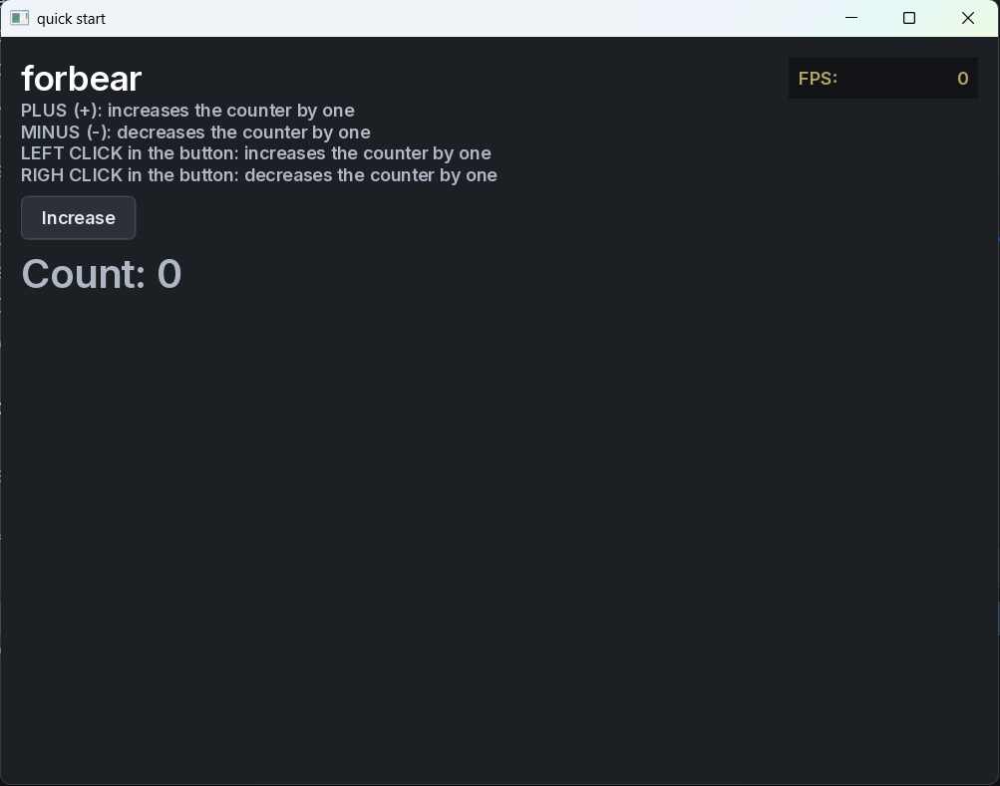

# forbear

forbear is a GUI library meant to be what operating systems should have given us. A high performance, handmade, cross-language immediate mode GUI library.
- React-like declarative elements, components and hooks;
- JSX bindings;
- easily embeddable and customizable;
- HTML-like element styling and flexbox-like layout;
- Cross-platform: Windows, Linux (wayland) and macOS.

<!-- TODO: provide a way to download some of what's in ./apps so that people can easily see what forbear is capable of. -->
<!-- TODO: in the future, add screenshots of programs built by the community with the library -->

## Quick start



Requirements: the Jai programming language, which is in private beta.

On Linux or macOS:
```sh
curl -fsSL https://forbear.dev/quick-start.sh | sh
```
On Windows, in PowerShell:
```powershell
irm https://forbear.dev/quick-start.ps1 | iex
```
To build:
```sh
cd untitled-program
jai main.jai +forbear
```

### At a glance

```jai
Counter :: () {
    // This gives us back a pointer to the counter's value. Since no initial value
    // is defined, the function just zeroes out the given type.
    //
    // State is stored in a 16MB static buffer with no heap allocations.
    counter := state(s64);

    // `text` defines a node with glyphs inside of it. It inherits style from its parent.
    text("PLUS (+): increases the counter by one");
    text("MINUS (-): decreases the counter by one");
    if on_key_down(.PLUS) {
        // Since this is immediate mode, there's no need for callbacks/event handlers,
        // we can simply check for the key being down through an if-statement.
        counter.* += 1;
    } else if on_key_down(.MINUS) {
        counter.* -= 1;
    }

    text("LEFT CLICK in the button: increases the counter by one");
    text("RIGHT CLICK in the button: decreases the counter by one");
    element(Style.{
        background = color(rgb(44, 49, 56)),
        color = rgb(230, 234, 239),
        border_width = all(1),
        border_color = rgb(66, 73, 82),
        border_radius = 6,
        padding = in_line(block(8), 16),
        margin = block(8),
    }, #code {
        node := get_node();
        if is_mouse_inside() {
            node.style.background = color(rgb(56, 62, 71));
            if is_mouse_held(.LEFT) || is_mouse_held(.RIGHT) {
                node.style.background = color(rgb(34, 38, 44));
            }
        }

        // The children of an element are defined through passing
        // around Code by the `#code` directive.
        text("Click me");

        if on_click(.LEFT) {
            counter.* += 1;
        } else if on_click(.RIGHT) {
            counter.* -= 1;
        }
    });

    text(Style.{font_size = 32}, sprint("Count: %", counter.*));
} @component
  // The `@component` is handled by a compiler plugin that's defined in the
  // `forbear.jai` as well. It goes through all calls of functions with this
  // annotation and wraps them in a `scope(#code ...)` which makes these handle
  // state properly.
```

## Why?

Among all current GUI framework options there seems to always be a trade-off between: beautiful, flexible, bare metal fast and DX.
The most famous pick for established programs people use every day is Electron. And Electron also picks its trade-off to not be bare metal fast.

forbear is meant to change this. forbear is meant to be the UI library that a proper operating system should have provided. The idea of it is
also to bring forth the possibility of defining UIs through any language you might already be familiar with.

## License

forbear is source available, not open source. It's free to use, copy and modify, and to ship inside your own programs.
If a product built with forbear makes more than USD $100,000 in a year, you pay a royalty of 1% of the revenue above that.
There is no royalty for internal tools, OSI-licensed open source projects, personal use, or non-profits.
You can't redistribute forbear itself as a standalone library, but you can build and sell your own libraries on top of it.

See [LICENSE](./LICENSE) for the full terms.

There are two reasons for this kind of licensing:
1) I believe that with something being paid for, the incentives are set up so that I can build the best UI library that has ever existed, by also freeing me up to work on it;
2) this UI library has become a bigger undertaking than I originally thought it would be, and I've invested a substantial amount of time into it.

## Roadmap

Beware forbear has been in heavy development since early 2025. The roadmap of the near future is:
- C ABI and C bindings.
- Async API that works with the immediate mode nature of the library and the different adapters.
- Complete Wayland and macOS windowing.
- Metal rendering on macOS.
- Native font rendering through FreeType, DirectWrite and CoreText.

For more of the planned work, see [TODO.txt](./TODO.txt).

---

<picture>
  <source media="(prefers-color-scheme: dark)" srcset="www/assets/forbear-definition-dark.png">
  
</picture>


