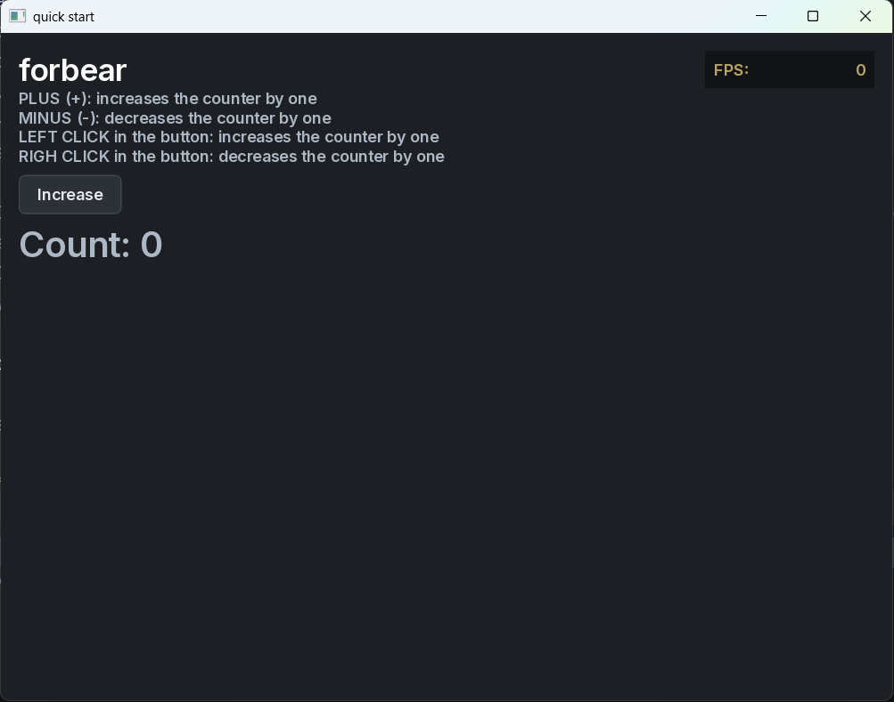
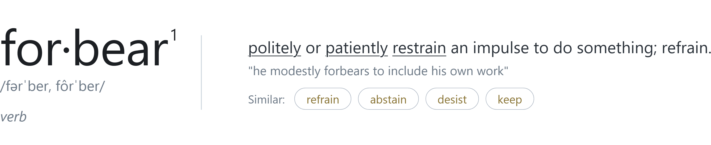

# forbear

forbear is a high performance, immediate mode GUI library that looks like the web.

Major features:
- React-like declarative elements, components, and hooks;
- HTML-like element styling and flex box-like layout;
- immediate mode event handling through if-statements;
- animations through transition and spring hooks;
- state stored in a static buffer, with no heap allocations;
- text shaping with variable fonts and per-language rules;
- cross-platform: Windows, Linux (Wayland) and macOS;
- C API through a dynamic library;
- easily embeddable and customizable;
- experimental JSX bindings.

<a href="https://github.com/gabrielmfern/Calculator"></a>

<!-- TO-DO: in the future, add screenshots of programs built by the community with the library -->

## Quickstart

The quickstart asks for a language, Jai or C.
Jai is in private beta, so if you don't have it, pick C. For C, you need MSVC on Windows, or gcc or clang on Linux and macOS.

On Linux or macOS:
```sh
curl -fsSL https://forbear.dev/quick-start.sh | sh
```
On Windows, in PowerShell:
```powershell
irm https://www.forbear.dev/quick-start.ps1 | iex
```
It ends by printing the commands to build your program.

The quickstart program should show this:



### At a glance

```jai
Counter :: () {
    // State is stored in a 16MB static buffer with no heap allocations.
    counter := state(s64);

    if on_key_down(.PLUS) {
        // Since this is immediate mode, there's no need for callbacks/event handlers,
        // we can simply check for the key being down through an if-statement.
        counter.* += 1;
    } else if on_key_down(.MINUS) {
        counter.* -= 1;
    }

    element(Style.{
        // styling familiar to HTML
        background = color(rgb(44, 49, 56)),
        color = rgb(230, 234, 239),
        border_width = all(1),
        border_color = rgb(66, 73, 82),
        border_radius = 6,
        padding = in_line(block(8), 16),
        margin = block(8),
    }, #code { // The children of an element are defined through passing
               // around Code by the `#code` directive.
        node := get_node();
        if is_mouse_inside() {
            node.style.background = color(rgb(56, 62, 71));
            if is_mouse_held(.LEFT) || is_mouse_held(.RIGHT) {
                node.style.background = color(rgb(34, 38, 44));
            }
        }

        text("Click me");

        if on_click(.LEFT) {
            counter.* += 1;
        } else if on_click(.RIGHT) {
            counter.* -= 1;
        }
    });

    text(Style.{font_size = 32}, sprint("Count: %", counter.*));
}
// Call it as `scope(Counter());` to give it its own state.
```

## Why?

Among all current GUI framework options there seems to always be a trade-off between: beauty, performance and developer experience. The most famous pick for established programs people use every day is Electron. Electron is famous for not having great performance and hogging way too many resources.

We have a vision of a world where, just like Electron programs are widespread, we have programs that use minimal resources, open, and close instantly, run using the hardware effectively widespread.

To reach this vision of the future, I believe there's the need for ease of development that has never gotten to before for UI libraries. Something that operating systems should have provided us from the beginning.

This is why forbear exists, it's meant to fuse the best of all worlds and make it accessible to all. High performance shouldn't be for only those who can bear the weight of extreme complexity, and beautiful UIs shouldn't be for only those who compromise for subpar performance.

## License

forbear is source available, not open source. It's free to use, copy and modify, and to ship inside your own programs.
If a product built with forbear makes more than USD $100,000 in a year, you pay a royalty of 1% of the revenue above that.
There is no royalty for internal tools, OSI-licensed open source projects, personal use, or nonprofits.
You can't redistribute forbear itself as a standalone library, but you can build and sell your own libraries on top of it.

See [LICENSE](./LICENSE) for the full terms.

There are two reasons for this kind of licensing:
1) I believe that with something being paid for, the incentives are set up so that I can build the best UI library that has ever existed, by also freeing me up to work on it;
2) this UI library has become a bigger undertaking than I originally thought it would be, and I've invested a substantial amount of time into it.

## Road map

Beware forbear has been in heavy development since early 2025 and the API that is established in the code will most likely change.

The road map for the near future is:
- Complete Wayland and macOS windowing.
- Async API that works with the immediate mode nature of the library and the different adapters.
- Metal rendering on macOS.
- Native font rendering through dynamically linked FreeType, DirectWrite and CoreText.

For more details, see [to-do.txt](./to-do.txt).

## Feedback

Bug reports and questions are welcome in [issues](https://github.com/gabrielmfern/forbear/issues) and [discussions](https://github.com/gabrielmfern/forbear/discussions).

---

<picture>
  <source media="(prefers-color-scheme: dark)" srcset="www/assets/forbear-definition-dark.png">
  
</picture>


